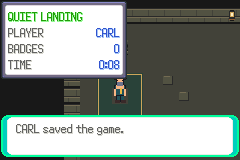
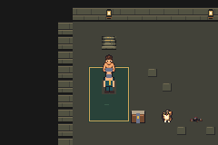

# Opening5 Guard Save passes; cold1 stops at STOP96

One authorized ordinary New Game process completed note, two earned Potions, guide recovery, offensive trial, earned Scrap, guide, Guard-first patrol, guide recovery and a manual Save at Quiet Landing35,1 (4,5), facing1. Opening PASS at native34117 includes all fourteen Save sectors/checksums and full decoded live/disk party, counts, flags, variables, logical resources, counter and legal field state. This is a Guard-only Save, not a complete patrol/full opening acceptance.

Conditional independent cold1 was admitted and started once after that Save passed. It stopped at native2044, phase13, STOP96: the full flags comparison fails because FLAG_SYS_TV_WATCH (2193/0x891) changes false→true. All other decoded fields match, including native canonical resources, both live/saved parties, six checksums, count2/savedCount2, counter78, variables, map/position/facing. Physical resource ciphertext and encryption context change natively on Continue; the retained raw3324-byte snapshots have383 physical differences, not one. The independent Save copy remains byte-identical. Cold acceptance fails; no assertion was relaxed, no flags were normalized, and no retry or further game process ran.

Pinned native source has CB2_ContinueSavedGame call InitMapFromSavedGame, which calls UpdateTVScreensOnMap; that routine starts by setting FLAG_SYS_TV_WATCH. This supports the flag-lifecycle explanation from source, not an instruction-by-instruction runtime trace. [Exact retained diagnosis](cold-stop-diagnosis.json) includes source hashes and a corrected post-run raw-comparison assumption. The initial read-only raw comparison assertion failed before writing results; it was corrected to distinguish ciphertext from decoded state. Runtime STOP remains immutable.

## Actual strategy and endpoint

Actual foe presence is validated and logged. Carl thresholds21 with both foes,15 with Guard alone,12 with Scuttler alone; Donut12 only while Scuttler remains. At Carl22/Donut23 with both alive, no Potion was spent. At Carl17/Donut20, Donut used one native Potion on Carl:17→33, gain16/waste4, stock2→1. Fresh A acknowledgement and full native transaction closure passed. Carl retained STRIKE/target; Donut used two SPARKs, one Potion and three WEAKENs. Guard victory left Carl25/36, Donut17/28; the guide then restored HP and uses normally. The final Carl STRIKE on Scuttler was critical (multiplier2, calculated damage23 to remainingHP18). [Retained54-transition battle review](actual-Guard-trace-review.json) cross-checks all six decisions and actual WEAKEN stages. Simultaneous critical risk remains explicit; this single trajectory establishes no survival guarantee.

| Manual Save state | Carl | Donut |
| --- | --- | --- |
| Level / XP | 10 / 627 | 9 / 937 |
| HP / max | 36 / 36 | 28 / 28 |
| Uses | 8 / 40 | 2 / 40 |
| Friendship / status | 81 / clear | 75 / clear |

Money3640, Potion1, Scrap2; trial and Guard win flags set. Howler/Warden/preparation/checkpoint/stairs/loop unset. [Decoded state and actual native medicine log](actual-state-and-medicine.json). Save SHA256 b88862308be4a5b58c7da79803106a29e9201d093d6e3be5307e226c556f63cf.

## Identities and verification

- Main/base b51e27d96f7ea43667ed20c4ce7bc7ca113d1eae. Accepted proposal037bc3cbcfaed70fb0979a88dae47c9383c7cf0c. Full offline tested sourcef53fc3a97ad20560ac9a7f9e14c3bb52d8a25128; wiring tested8e7598ea1ca2db13216498af9e7c2c6ecf34484f; frozen/published/executed helper55556fc5f352d8fe2f8d17db73123dad9ee09fb8. Runtime helper source unchanged after freeze. [Actual identity/result pins](actual-results.json), [reviewed artifact registry](reviewed-artifacts.json), [separately named contract](../../../../floor1/c01-conserve-medicine-opening5-r1-contract.md).
- Retained compiled game4a92a9de70848b9d7275f9f255bb0d2f53232ab8, engine0fedd142f43f136ceee189c54101b095fc88f495. ROM79a0ed7621399bab8aa38ca00fbc3515fb69c4d84ade798a370bcc08d1c29246; ELF7895d09e2d2f94e699ccd4f0d19e302e21d3d9d8991709abbfd4ba82e222536d. No game rebuild or engine edit. Observer C a5c38fcc695c53127d9f9593f9fb47a801912b97702c77d1b7b7ebe83353c1e7; binary5223546d319a68907e22a867c81220f547a098928cef8b5cc59f3eb4196303b5.
- GCC14.2.0, ARM binutils2.44-3+23+b1, agbcc sourceda598c1d918402c42c0c0d7128ba14567f3175e9 and libmGBA0.10.5 manifest identities were rechecked. Recovered compilers differ from historical binaries; original-tool identity is not claimed. Full11734-entry retained engine manifest and dependencies were rehashed.
- [Fresh full offline results](offline-results.json):148248 policy vectors,33 actual-reader mocks, both recipients/eight medicine UI cases/two successive uses,24180 transaction positives/116756 negatives,32970 physical snapshot corruptions,2140 instruction checks and60 native completion cases. These are offline checks. [74 wiring/admission negatives](wiring-offline-results.json) passed before freeze. Actual runtime exercised one medicine closure and the full opening phase/Save checks; cold failed.

## Captures and private retention

[Opening native motion,34117 frames](opening/native-review.mp4), [cold native motion through STOP,2044 frames](cold/native-review.mp4), [opening export receipt](opening/actual-export-receipt.json), [cold export receipt](cold/actual-export-receipt.json). Both videos contain all actual frames at262144/4389 FPS,240×160; they are lossy bounded review copies. Each public PNG was pixel-checked against its indexed raw RGB frame. The medicine-healed screenshot catches native HP animation32/33; the transaction state/log verifies completed33/33. opening/cold.png names the initial New Game capture, not independent cold verification. cold/first-failure.png is the independent process STOP image. Screenshots were inspected; no human full-video pacing/comprehension acceptance is claimed.

Full raw indexed34117+2044 frames, private traces, Saves, symbols, builds, contracts, claims and STOP remain local. [Private retention summary](private-retention-summary.json) reports exact bytes/bounds/manifests and hash readback. Full unchanged10000408128-byte admission reservation, including256MiB headroom, fit before preparation/admission; no ceiling was reduced. No raw compression/deletion, ROM/Save/raw public release or private transfer. Local verified retention is not an independent backup. A separately authorized private object-store transfer or user-controlled download with verified readback is an option; neither has been performed or verified.

Opening total claims/processes5/5; cold1/1. Prior STOP82/90/104/101 unchanged; previous opening4 full102-entry manifest and older98-entry/31-compressed-chunk manifests rehashed exactly, without representation changes. Historical V01 six baseline/four candidate executions and STOP117 at requestedvisual8536 before expectedB8402; later pair1/1, ordinary recovery5 and C01a actual5/3/1 versus claims6/3/1 remain distinct. Library five failed uploads plus one failed supported existing-backup download remain unknown-cause/zero original bytes/no retry.

## Review checkpoint

Stop idle on draft PR117; no merge. Main, all other branches, issue116, accepted nine-district plan and old evidence remain preserved. Next dependency is read-only review of native Continue TV-watch flag lifecycle against the strict full-flag contract. Any proposed contract/source change or further freeze/claim/execution requires separate review. Full C01 opening/Howler/Warden, original oracle, legacy Save acceptance, human comprehension/pacing, both branch orders/optional skips and full-floor obligations remain open.
